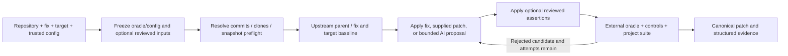

# Package structure and verification flow

```text
src/seam/
├── agent/
│   ├── instructions/      # Trusted system and retry prompts
│   ├── google_model.py    # Disable hidden Gemini follow-up requests
│   ├── pricing.py         # Cumulative request accounting
│   ├── native.py          # Maintained SDK clients with explicit authentication
│   ├── providers.py       # One PatchAgent and compatibility entry points
│   ├── schemas.py         # Tool argument validation and generated schemas
│   ├── session.py         # Bounded tool conversation
│   ├── tools.py           # Confined workspace access
│   └── transport.py       # Native model requests and bounded connection lifecycle
├── cli/
│   ├── application.py     # Commands and argument validation
│   ├── credentials.py     # Bounded explicit controller credential selection
│   ├── evals.py           # Public case replay and qualification commands
│   ├── providers.py       # Provider configuration and common agent construction
│   └── presentation.py    # Terminal output and exit statuses
├── demo/
│   ├── resources/         # Synthetic source, tests, oracle, and Dockerfile
│   ├── fixture.py         # Divergent release history and reference adaptation
│   └── image.py           # Trusted demo image build
├── evals/
│   ├── catalogue.py       # Bounded case loading and catalogue export
│   ├── models.py          # Immutable case input validation
│   ├── qualification.py   # Repeated references and executed negative checks
│   └── runner.py          # Pinned public source replay and run manifests
├── execution/
│   ├── resources/         # Container bootstrap program
│   ├── container.py       # Constrained container arguments
│   ├── docker.py          # Image resolution, lifecycle, and watchdog
│   ├── processes.py       # Bounded host processes and cleanup
│   └── snapshot.py        # Bounded snapshots and pinned reviewed fixtures
├── verification/
│   ├── assessment.py      # Evidence classification
│   ├── config.py          # Trusted TOML loading
│   ├── junit.py           # Bounded report reading and parsing
│   ├── reporting.py       # JSON and Markdown report persistence
│   ├── reviewed_tests.py  # Reviewed assertion-only test patch validation
│   └── workflow.py        # Four-revision run coordinator
├── constants/
│   ├── agent.py           # Conversation and tool bounds
│   ├── demo.py            # Demo image defaults
│   ├── evals.py           # Catalogue and image build bounds
│   ├── execution.py       # Process, staging, and Docker limits
│   ├── providers.py       # Provider endpoints, credential names, checked rates
│   ├── repository.py      # Git and patch constraints
│   ├── security.py        # Credential fields and sensitive file policy
│   └── verification.py    # Configuration and evidence bounds
├── security/
│   ├── content.py         # Offline maintained detectors and literal normalization
│   ├── files.py           # Bounded explicit controller configuration reads
│   └── paths.py           # Credential exclusions and reviewed fixture pins
├── exceptions.py          # Repository, execution, and agent error types
├── models.py              # Shared records and validated data
└── repository.py          # Local Git inspection, cloning, and patch confinement
```

`agent`, `cli`, and `demo` expose their public entry points through small
`__init__.py` files. Implementation modules use explicit absolute imports.
Resource loading uses `importlib.resources`, including when installed from a
wheel. Tests follow the same subsystem directories; `test_integration.py`
connects the SDK protocol, Git operations, and real Docker execution.

## Dependency direction

The CLI selects explicit inputs and invokes `verification.workflow.run_backport`.
The workflow uses the Git adapter and Docker runner to collect evidence. It
accepts a small `PatchProposer` protocol; it does not depend on a model provider.
The agent composes a bounded tool session, native model transport, and usage
ledger. PydanticAI's low-level model adapters translate native messages, tool
results, and usage; Seam retains the tool loop and verification policy.
Neither the model nor the transport can classify a verification result.

Evaluation commands load reviewed cases through `evals.catalogue` and replay
them through the same verification workflow. `evals.qualification` repeats the
reference and requires rejection of a negative candidate. The source assets in
`evals/python/` are bundled under `seam/evals/data/python` in installed wheels.

Named defaults, provider endpoints and rates, and security limits live in
focused `seam.constants` modules; domain error types live in `seam.exceptions`.
The constants package does not re-export an umbrella namespace. Callers import
these definitions rather than duplicating values or declaring local exceptions.
`seam.models` owns shared records and validation schemas. Prompts and executable
fixture text are package resources, loaded by the subsystem that uses them.

## One run



The coordinator freezes the oracle and configuration before any adaptation. It
requires the security assertion to reproduce on both vulnerable baselines and
requires working controls on every revision. The backport must preserve the
target's collected suite cases. Reports include the immutable commits, execution
image, input hashes, candidate outcomes, and optional model usage.

Optional fixture pins are checked before image preparation and on every staged
snapshot. The target baseline keeps its original tests; reviewed assertion edits
accompany candidate checks and the canonical export. Model proposals retain the
implementation-only path policy. Human review determines assertion strength.

Git recalculates generated hunk lengths while retaining context, path, mode, and
whitespace checks. The exported patch is a canonical diff of the actual tested
changes. Raw rejected proposals remain available for review.

This verification assumes reviewed target code cooperates with pytest. Target
code runs in pytest's process and could forge reports or interfere with
collection. Frozen inputs do not make runtime evidence tamper-resistant. See the
[threat model](security.md) for the execution boundary and its limits.
