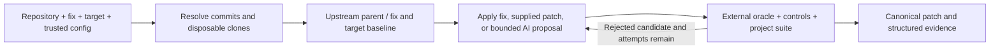

# Package structure and verification flow

```text
src/backport_harness/
├── agent/
│   ├── instructions/      # Trusted system and retry prompts
│   ├── pricing.py         # Model rates and cumulative request accounting
│   ├── providers.py       # OpenAI and DeepSeek adapters
│   ├── session.py         # Bounded tool conversation
│   ├── tools.py           # Tool schemas and confined workspace access
│   └── transport.py       # Fixed endpoints and provider request dialects
├── cli/
│   ├── application.py     # Commands and argument validation
│   ├── credentials.py     # Explicit local key selection and provider creation
│   └── presentation.py    # Terminal output and exit statuses
├── demo/
│   ├── resources/         # Synthetic source, tests, oracle, and Dockerfile
│   ├── fixture.py         # Divergent release history and reference adaptation
│   └── image.py           # Trusted demo image build
├── execution/
│   ├── resources/         # Container bootstrap program
│   ├── container.py       # Constrained container arguments
│   ├── docker.py          # Image resolution, lifecycle, and watchdog
│   ├── processes.py       # Bounded host processes and cleanup
│   └── snapshot.py        # Bounded source staging without credentials
├── verification/
│   ├── assessment.py      # Evidence classification
│   ├── config.py          # Trusted TOML loading
│   ├── junit.py           # Bounded report reading and parsing
│   ├── reporting.py       # JSON and Markdown report persistence
│   └── workflow.py        # Four-revision run coordinator
├── models.py              # Shared validated records
└── repository.py          # Local Git inspection, cloning, and patch confinement
```

`agent`, `cli`, and `demo` expose their public entry points through small
`__init__.py` files. Implementation modules use explicit absolute imports.
Resource loading uses `importlib.resources`, including when installed from a
wheel. Tests follow the same subsystem directories; `test_integration.py`
connects the SDK protocol, Git operations, and real Docker execution.

## Dependency direction

The CLI selects explicit inputs and invokes `verification.workflow.run_backport`.
The workflow uses the Git adapter and Docker runner to collect evidence. It
accepts a small `PatchProposer` protocol; it does not depend on a model provider.
Provider adapters compose a tool session, HTTP transport, and usage ledger.
Neither the model nor the transport can classify a verification result.

Constants stay with the policy they describe: rates in pricing, read limits in
tools, and staging limits in snapshot. Prompts and executable fixture text are
resources rather than source strings inside the orchestration code. There is no
global constants or utilities module.

## One run



The coordinator freezes the oracle and configuration before any adaptation. It
requires the security assertion to reproduce on both vulnerable baselines and
requires working controls on every revision. The backport must preserve the
target's collected suite cases. Reports include the immutable commits, execution
image, input hashes, candidate outcomes, and optional model usage.

Git recalculates generated hunk lengths while retaining context, path, mode, and
whitespace checks. The exported patch is a canonical diff of the actual tested
changes. Raw rejected proposals remain available for review.

This verification assumes reviewed target code cooperates with pytest. Target
code runs in pytest's process and could forge reports or interfere with
collection. Frozen inputs do not make runtime evidence tamper-resistant. See the
[threat model](security.md) for the execution boundary and its limits.
