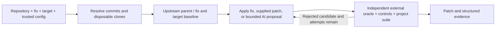

# One run, explicit evidence

`core.py` owns the state transitions and classification. It resolves immutable
inputs, freezes verification inputs, requires valid baseline evidence, and
coordinates bounded adaptation attempts. Neither the agent nor container output
can directly set the final status.

This independence separates the model's claim from measured test outcomes under
the assumption that the reviewed target cooperates with pytest. Target code runs
in pytest's process and could interfere with collection or forge JUnit output.
Frozen input files do not make the runtime evidence tamper-resistant; review the
source and candidate before relying on a successful report.

`repository.py` handles disposable clones and patch application. `processes.py`
provides bounded subprocess execution with a restricted host environment and
process-group cleanup. `runner.py` resolves the chosen image and launches
restricted containers, then parses their pytest evidence.

`agent.py` implements the optional OpenAI Responses tool loop. Its tools expose
bounded source reads and candidate submission rather than shell execution. It
reserves a known maximum request cost before every model call, caps model
iterations, and returns a patch for the core to evaluate.

`models.py` validates configuration, tool boundaries, and structured reports.
`cli.py` exposes execution, report inspection, prerequisite checks, and the
keyless demonstration. `demo.py` constructs real divergent Git history for a
clearly labeled synthetic archive-path vulnerability.

The first release handles one ordinary upstream commit, one maintained target,
one trusted pytest oracle, and one prebuilt image per run. It deliberately avoids
an orchestration framework, hosted UI, database, automatic PR creation, and
unrestricted model tools. These boundaries keep a run inspectable and make its
failure conditions explicit.
